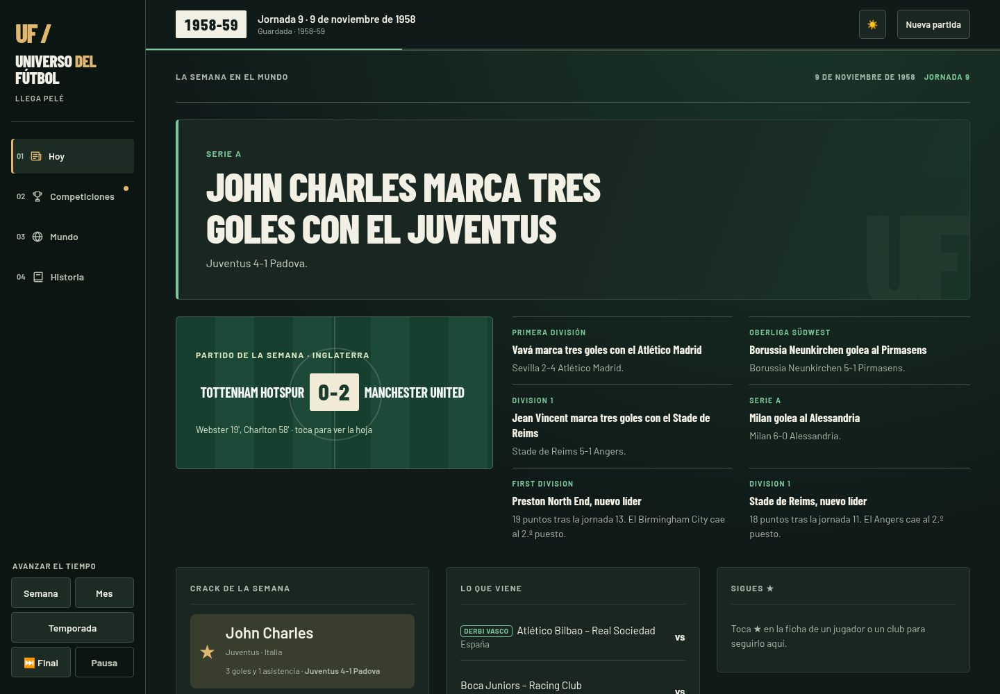
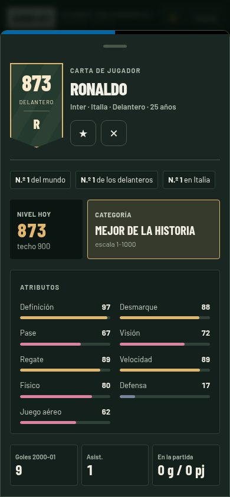

# Archivo de leyendas · capturas y comprobaciones

Evidencias del rediseño de Universo del fútbol. Esta rama contiene únicamente capturas y resultados de comprobación; no se incorpora al código del juego.

El cambio de aplicación afecta solo a `css/estilos.css`, `index.html` y funciones que pintan pantallas de `js/app.js`. No altera los archivos del motor, los datos ni la versión de guardado (24).

## Antes y después

Ordenador: 1440 × 1000. Móvil: 390 × 844. Las capturas comparan la misma época, semilla (7), jornada y jugador/club por dispositivo. Ordenador empieza en 1958 y móvil en 2000. Las imágenes no incluyen recortes ni retoques.

| Pantalla | Ordenador antes | Ordenador después | Móvil antes | Móvil después |
| --- | --- | --- | --- | --- |
| Inicio | [Ver](antes/ordenador-inicio.jpg) | [Ver](despues/ordenador-inicio.jpg) | [Ver](antes/movil-inicio.jpg) | [Ver](despues/movil-inicio.jpg) |
| Hoy | [Ver](antes/ordenador-hoy.jpg) | [Ver](despues/ordenador-hoy.jpg) | [Ver](antes/movil-hoy.jpg) | [Ver](despues/movil-hoy.jpg) |
| Competiciones | [Ver](antes/ordenador-competiciones.jpg) | [Ver](despues/ordenador-competiciones.jpg) | [Ver](antes/movil-competiciones.jpg) | [Ver](despues/movil-competiciones.jpg) |
| Ficha de jugador | [Ver](antes/ordenador-jugador.jpg) | [Ver](despues/ordenador-jugador.jpg) | [Ver](antes/movil-jugador.jpg) | [Ver](despues/movil-jugador.jpg) |
| Ficha de club | [Ver](antes/ordenador-club.jpg) | [Ver](despues/ordenador-club.jpg) | [Ver](antes/movil-club.jpg) | [Ver](despues/movil-club.jpg) |
| Historia | [Ver](antes/ordenador-historia.jpg) | [Ver](despues/ordenador-historia.jpg) | [Ver](antes/movil-historia.jpg) | [Ver](despues/movil-historia.jpg) |
| Fin de temporada | [Ver](antes/ordenador-fin.jpg) | [Ver](despues/ordenador-fin.jpg) | [Ver](antes/movil-fin.jpg) | [Ver](despues/movil-fin.jpg) |

## Comprobaciones

- Antes de modificar código se jugó una temporada completa en cada tamaño y se anotó el diagnóstico.
- `node --check js/app.js`: correcto.
- `node pruebas/auditoria.js`: todo bien. Salida completa en [auditoria.txt](auditoria.txt).
- Navegador Chromium con Playwright: 1958-59 y 1959-60 en ordenador; 2000-01 y 2001-02 en móvil. Sin errores de JavaScript ni de consola.
- Se revisaron 125 vistas de competiciones en ordenador y 84 en móvil, incluyendo tablas, partidos, goleadores, figuras, datos y el Mundial. Ningún desbordamiento horizontal en las tablas, filtros y resultados comprobados.
- Recargar recupera año, semilla y posición de la partida. El inicio permite continuarla.
- Al terminar, la temporada permanece detenida hasta pulsar el botón correspondiente.
- Seguir jugador y comparar dos jugadores funcionan. El mapa móvil de campeones se abre por país y conserva los enlaces a clubes.
- Movimiento reducido: duración de animaciones de sección de 0 s.
- Contraste de tinta, texto secundario y acento respecto al fondo y las tarjetas en los temas claro y oscuro, para 1958, 1970, 1986 y 2000: mínimo 4,79:1. Esta comprobación corresponde a esos colores de texto; no es una auditoría completa de accesibilidad.
- Los cierres antes/después coinciden: Real Madrid gana liga y Europa en 1958-59; Barcelona gana liga y Liverpool Europa en 2000-01, con la misma semilla y posición.

[Registro del navegador](navegador.txt) · [Resultado anterior](antes/comprobacion.json) · [Resultado posterior](despues/comprobacion.json) · [Diagnóstico visual](diagnostico.md)

También hay capturas de los temas [claro en ordenador](despues/ordenador-claro.jpg) y [claro en móvil](despues/movil-claro.jpg), y del inicio con partida guardada en [ordenador](despues/ordenador-continuar.jpg) y [móvil](despues/movil-continuar.jpg).

Para cargar las tipografías ya existentes desde el navegador de pruebas, Playwright acepta el certificado del proxy del entorno. No se cambia la configuración de seguridad del juego. El estado anterior corresponde a a022a41; el rediseño incorpora además la corrección del motor publicada por otra persona en f7bbb0b, sin modificarla.
