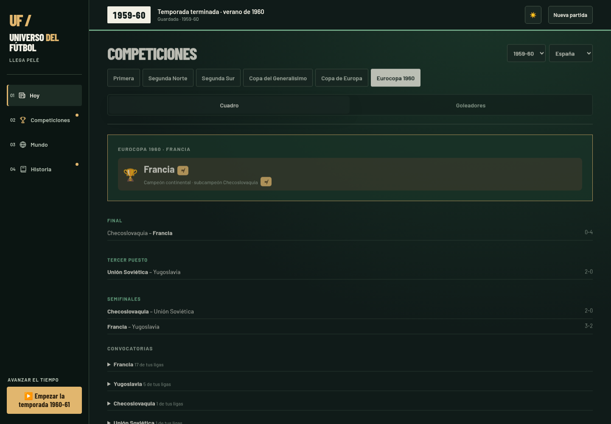
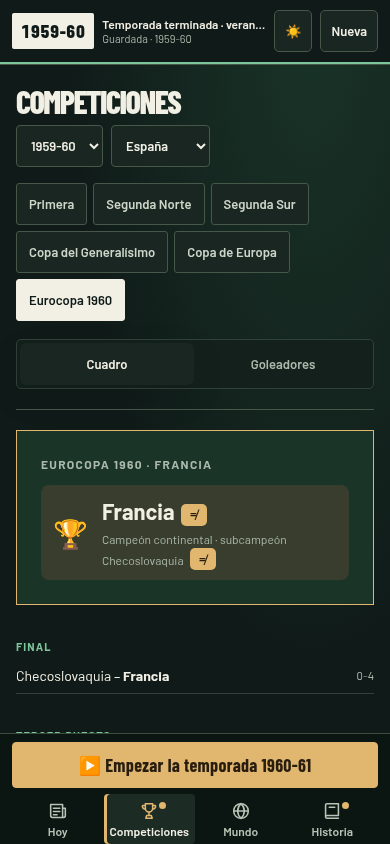
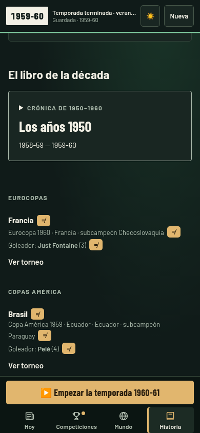
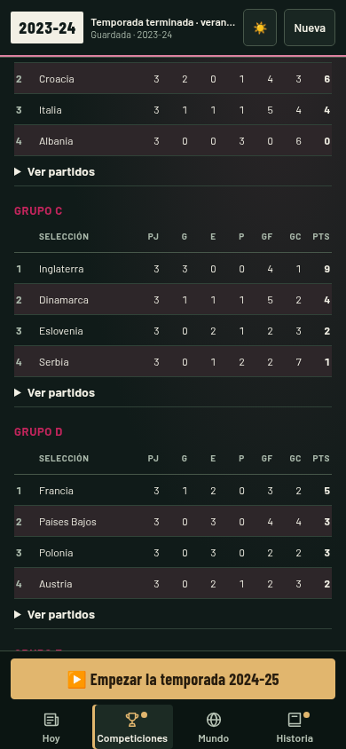
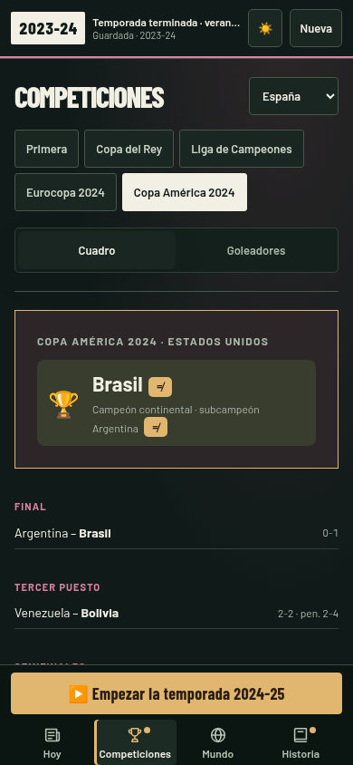
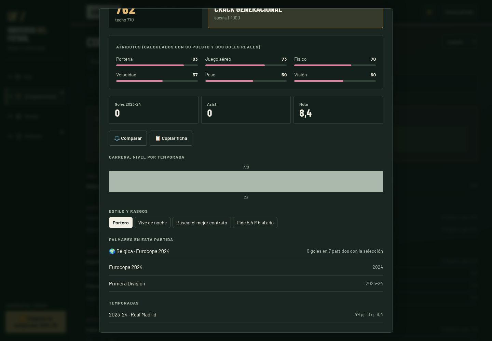

# Eurocopa y Copa América: comprobación

Se añaden las 40 ediciones históricas de ambas competiciones que caben en la
partida. En 1959 se conservan los dos torneos y sus estadísticas por separado.
La Eurocopa 2020 se disputa en 2021. Competiciones, Historia, la ficha del
jugador y el Balón de Oro incorporan los resultados de la partida; las
referencias reales se consultan únicamente mediante ≠.

`R.EURO` guarda un torneo; `R.AMERICA` guarda una lista, necesaria por 1959.
`mundo.js` solo incorpora una llamada junto al Mundial. `motor.js` no cambia.
El módulo del Mundial recibe opciones de reglamento para reutilizar sus
partidos y penaltis; cuatro muestras de Mundiales conservan exactamente los
resultados anteriores, comprobados con una huella SHA-256.

El guardado pasa de 32 en `main` a 33 en sus dos puntos de lectura/escritura.
Esto reinicia los guardados anteriores al incorporar las nuevas estadísticas.

## Pruebas

```sh
node pruebas/continentales.js
node pruebas/auditoria.js
node pruebas/famosos.js
node pruebas/partida.js 1958 12 5
node pruebas/partida.js 2000 26 7
node --check js/app.js
```

La prueba continental recorre las 40 ediciones con tres semillas, comprueba
el número histórico de participantes y que todos los torneos terminan,
descarta cruces repetidos y comprueba la asignación de los mejores terceros.
También reproduce bajas largas, retiros, doble nacionalidad, dos torneos en
1959, la Eurocopa aplazada y el bonus de medio Mundial.

En Chromium se jugaron dos temporadas desde 1958 hasta la Eurocopa 1960 y
cuatro desde 2000 hasta la Eurocopa 2004 mediante los botones de avance.
Se verificaron los enlaces desde Historia a temporadas anteriores, el
guardado al recargar y que el año no avance solo. Otra partida desde 2023
comprobó las 24 selecciones de la Eurocopa y las 16 de la Copa América 2024,
el palmarés de un campeón y los grupos en móvil de 390 px. Sin errores de
consola ni desbordamiento horizontal en esta última comprobación.

Las capturas muestran resultados simulados, no los campeones reales.
Las lagunas de las plantillas antiguas y los niveles estimados se detallan
en [la cobertura de los datos](../datos_fuente/continentales/README.md).

## Capturas

Dos Copas América en la misma temporada:


Eurocopa de cuatro selecciones en ordenador y móvil:




Historia y grupos modernos en móvil:





Títulos y estadísticas de selección en el palmarés de un jugador de la partida:


